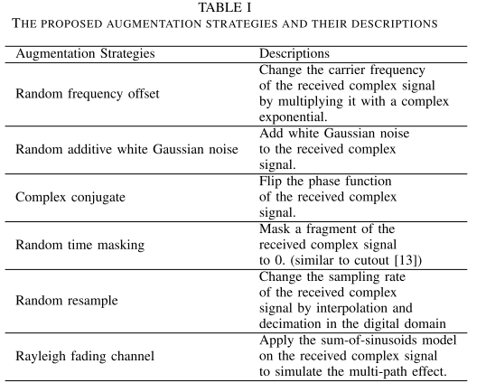
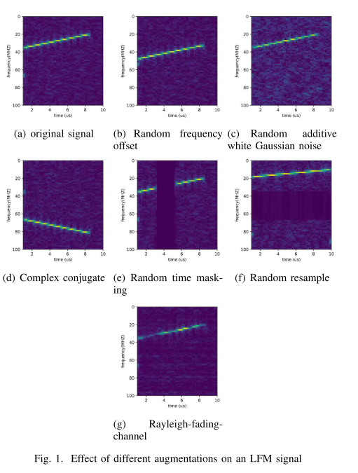
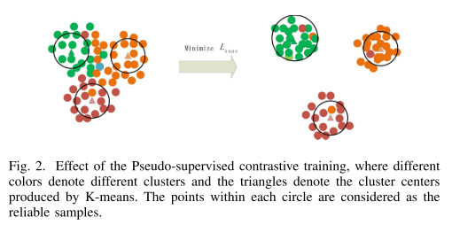
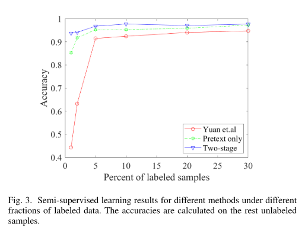
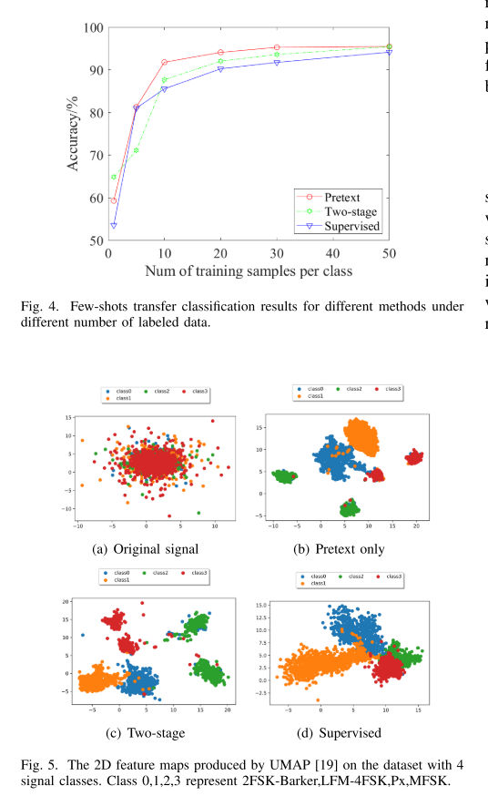

# Radar Signal Selection Based on Data Augmentation and Classification of Intra-pulse Modulation in Radar Signals - A Comparative Representation Learning Method with MATLAB Codes

Introduction: The automatic classification of radar waveforms is a significant task in modern radar countermeasures. Accurate classification of radar waveforms can assist radar reconnaissance systems in pulse selection and determination of the functionality and type of enemy radars.
Currently, researchers are primarily focused on deep learning-based methods for radar waveform classification. Some approaches based on deep learning convert radar signals into time-frequency images (TFI) and utilize deep learning network structures from the computer vision field to classify TFI. Wang et al. [1] used the Wigner-Ville distribution to generate TFI and designed a CNN for image classification that outperformed methods based on autocorrelation. In [2], a convolutional denoising autoencoder was proposed for 12 modulated signal within pulses. Under low signal-to-noise ratio conditions, this method effectively removes noise from TFI signals, achieving high recognition accuracy. Other researchers have used raw one-dimensional (or two-dimensional IQ) radar signals as input to design network architectures, such as CNNs and their variants [3], [4], and methods based on long short-term memory (LSTM) networks [5]. Without any feature extraction techniques, these methods achieve comparable performance to those using TFI. These deep learning-based methods are supervised and require a large amount of labeled signals to function properly. In actual war scenarios, captured waveforms may always contain unknown modulations, although models can be retrained to adapt to new environments, but labeled data may be very time-consuming and require extensive expertise [6], [7].
The latest advancements in self-supervised representation learning have achieved great success in the fields of natural language processing (NLP) and computer vision (CV). Devlin et al. [8] proposed a bidirectional Transformer to predict masked tokens self-supervised, significantly outperforming previous state-of-the-art methods across 11 downstream tasks. Chen et al. [9] introduced a simple contrastive learning framework (Simplified), which outperformed previous supervised models using only 1% labeled data on ImageNet. In the field of radar signal classification, Mi et al. [10] proposed a contrastive time-frequency learning method that uses the TFIs generated by multi-synchronous compression transforms to classify six types of radar signals, achieving better classification accuracy than a multilayer perceptron (MLP) under low signal-to-noise ratios.
In this paper, instead of using TFI for contrastive learning, we adjust the original IQ input due to two reasons. First, converting signals into TFI would significantly increase the computational cost for feature extraction in the encoder network, requiring very long training times. Second, the performance of these contrastive self-supervised methods largely depends on the choice of data augmentation strategies, and using TFI for enhancement may be inconvenient. Additionally, we propose an additional pseudo-supervised contrastive training phase to further promote inter-class separation and reduce intra-class variation. Qualitative experiments show that this method outperforms many downstream classification tasks in various representation learning tasks.
Figure caption: Conclusion - This paper mainly studies the representation learning of radar signals. Trained models using the proposed enhanced strategy can automatically extract useful features from received IQ data points with less prior information for classification. It can even generalize to new signal categories with different signal-to-noise ratios, providing a promising method for identifying radar waveforms with unknown modulations.

## Images

<!-- PAYMENT_BLOCK -->

## Get this dataset

- Payment link (Stripe): [Buy now](https://buy.stripe.com/3cs8yP7sY87d0vu9AB)
- Payment QR code: 

<!-- /PAYMENT_BLOCK -->
